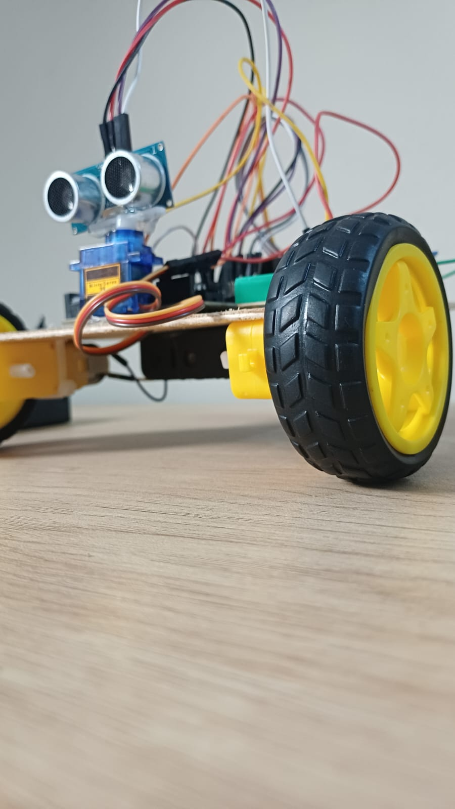
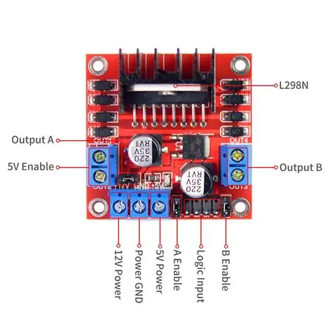
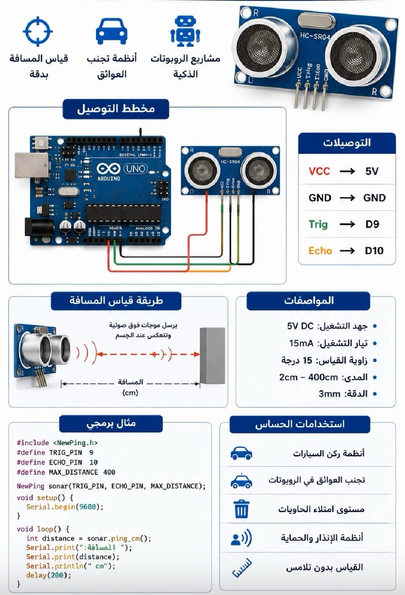
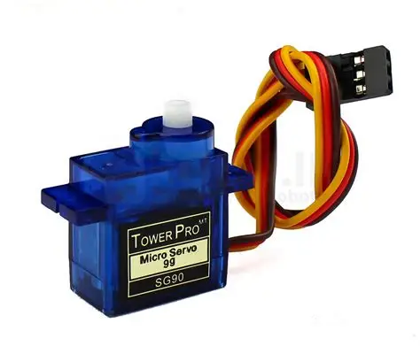

# Arduino Obstacle Avoiding Car 🤖

An Arduino-based autonomous robot car that detects obstacles using an ultrasonic sensor and automatically changes direction to avoid collisions.

This project is designed for beginners in Robotics and Embedded Systems, featuring detailed code comments to explain every important line, function, and operation.

---

## 📌 Project Overview

The robot continuously measures the distance to objects in front of it using an ultrasonic sensor.

When an obstacle is detected within a predefined distance, the car stops, moves backward, scans both the right and left directions using a servo motor, and automatically turns toward the direction with more available space.

<p align="center">
  
</p>

---

## ✨ Features

- Automatic obstacle detection.
- Ultrasonic distance measurement.
- Servo-controlled scanning in multiple directions.
- Automatic left and right turning.
- Four DC motor control.
- Gradual motor speed increase.
- Detailed code comments for educational purposes.

---

## 🧰 Hardware Requirements

### 1. Arduino Uno

The main microcontroller responsible for processing sensor readings and controlling the robot.

<p align="center">
  
</p>

### 2. Motor Driver Shield (Adafruit Motor Shield V1)

Used to control the direction and speed of the four DC motors.

<p align="center">
  
</p>

### 3. Ultrasonic Sensor (HC-SR04)

Used to measure the distance between the robot and nearby obstacles.

<p align="center">
  
</p>

### 4. Servo Motor

Rotates the ultrasonic sensor to scan the right and left directions.

<p align="center">
  
</p>

### 5. Other Components

- 4 DC geared motors.
- Robot car chassis with four wheels.
- External motor power supply.
- Jumper wires.

---

## 🔌 Circuit Diagram & Connections

The following diagram illustrates the main electrical connections between the Arduino, Motor Shield, ultrasonic sensor, and other components.

<p align="center">
  
</p>

### Ultrasonic Sensor (HC-SR04)

| Sensor Pin | Arduino Pin |
|---|---|
| VCC | 5V |
| GND | GND |
| TRIG | A0 |
| ECHO | A1 |

### Servo Motor

| Servo Wire | Connection |
|---|---|
| Signal | D10 |
| VCC | Suitable 5V supply |
| GND | Common GND |

### DC Motors

The four DC motors are connected through the Motor Shield:

| Motor | Shield Port |
|---|---|
| Motor 1 | M1 |
| Motor 2 | M2 |
| Motor 3 | M3 |
| Motor 4 | M4 |

**Important:** Verify the shield version, motor polarity, and power connections before operating the robot.

---

## 📚 Software Requirements

- Arduino IDE.
- AFMotor Library.
- NewPing Library.
- Servo Library.

### Required Libraries

Install the following libraries before uploading the code:

1. **AFMotor Library:** For controlling DC motors using Adafruit Motor Shield V1.
2. **NewPing Library:** For ultrasonic distance measurement.
3. **Servo Library:** For controlling the servo motor.

Library Resources:

- [NewPing Library](https://github.com/livetronic/Arduino-NewPing)
- [Arduino Servo Library](https://github.com/arduino-libraries/Servo)
- [AFMotor Library Installation Guide](https://learn.adafruit.com/adafruit-motor-shield/library-install)

---

## ⚙️ How It Works

The robot follows a simple obstacle avoidance algorithm:

1. Initialize the ultrasonic sensor, servo motor, and motor control objects.
2. Measure the distance in front of the robot.
3. Move forward while the measured distance is greater than 15 cm.
4. Stop and move backward when an obstacle is detected within 15 cm.
5. Scan the right direction using the servo motor.
6. Scan the left direction and compare the measured distances.
7. Turn toward the direction with the greater measured distance.
8. Repeat the process continuously.

### Robot Decision Logic

```text
       Start
         |
         v
  Measure Distance
         |
         v
   Distance <= 15 cm?
      /         \
    Yes          No
     |            |
     v            v
  Stop Car     Move Forward
     |
     v
 Move Backward
     |
     v
 Scan Right & Left
     |
     v
 Compare Distances
     |
     v
 Turn to the
 Clearer Direction
     |
     v
  Repeat Process
```

---

## 🚀 Getting Started

1. Install the Arduino IDE.
2. Install all required libraries.
3. Connect the ultrasonic sensor and servo motor.
4. Connect the four DC motors to the Motor Shield.
5. Open the `.ino` file in Arduino IDE.
6. Select **Arduino Uno** and the correct COM port.
7. Upload the code to the Arduino board.
8. Place the robot in an open test area and verify its movement.

---

## 🎯 Learning Objectives

By studying this project, you will learn:

- Arduino programming fundamentals.
- Functions, variables, conditions, and loops in C++.
- Ultrasonic sensor operation.
- Servo motor positioning.
- DC motor direction and speed control.
- Autonomous robot navigation.
- Basic obstacle avoidance algorithms.
- Hardware and software integration.

---

## ⚠️ Notes and Limitations

- This project uses an Adafruit Motor Shield V1-compatible AFMotor library.
- Motor Shield V2 requires a different library and code.
- Servo angles may need adjustment depending on the mechanical installation.
- The 15 cm detection threshold can be modified in the code.
- Ultrasonic readings may be affected by object shape, surface, and sensor orientation.
- A zero distance reading is treated as 250 cm in the original code, so a failed reading may be interpreted as a clear path.
- Test the robot at low speed and keep the wheels clear of obstructions during initial testing.

---

## 🔮 Future Improvements

- Add Bluetooth or Wi-Fi remote control.
- Integrate additional sensors.
- Improve obstacle detection and turning logic.
- Add adjustable speed settings.
- Develop a more advanced navigation algorithm.

---

## 👨‍💻 Author

**Mahmoud Abo Elnaga**

Robotics & AI | Arduino | Embedded Systems

---

## 📄 License

This project is available for educational and learning purposes.

A suitable open-source license can be added to define how others may reuse and distribute the code.
